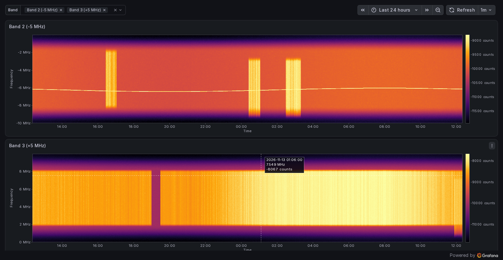
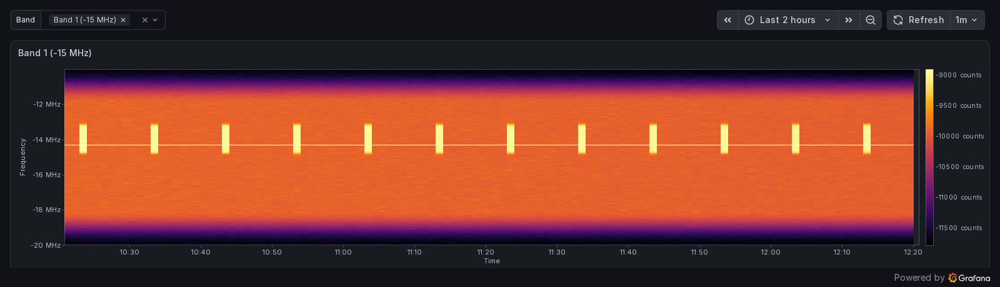

# RF Spectrogram panel for Grafana

A Grafana panel plugin that draws power spectral density (PSD) records as a
time × frequency heatmap. Each record is one spectrum: a band number, a
timestamp, and an array of i16 frequency bins. The panel stacks records along
the dashboard's time axis, so a feed that writes one record per band per
minute becomes a scrolling waterfall in Grafana.



## Features

- **Time axis follows the dashboard.** The time picker, auto-refresh,
  drag-to-zoom and double-click-to-zoom-out all work. Missing records show as
  gaps instead of being squeezed out.
- **Pixel aggregation.** When zoomed out, records and bins that share a screen
  pixel are combined with max-hold, so short bursts stay visible, or with the
  mean. A day of one-minute records (1440 × 1024 cells) renders at full speed.
- **Frequency axis in Hz.** Each record carries its band's center and span, so
  bins are placed and labelled correctly. Several bands in one query are
  merged onto a single axis.
- **Colour scale.** Five colormaps. The automatic range uses percentiles, so
  outliers don't wash out the image; you can also fix the min and max.
  Normalization is absolute or per time column. The colour bar uses
  Grafana's standard unit setting.
- **Hover readout** with time, frequency and value.
- **Compact queries.** One row per record (bins sent as base64), so a day is
  1440 rows per band and takes roughly 130 ms from PostgreSQL. A long format
  (one row per time × bin) is also accepted.



## Quick start

Requirements: Node.js 24.5+ (see `.nvmrc`), Docker with Compose v2.20+ (for `include:`), and
Python 3 with NumPy if you want to generate record files on the host.

```bash
npm install
npm run build
npm run server            # Grafana :3123, PostgreSQL :3125, synthetic live feed
```

Open <http://localhost:3123/d/rf-spectrogram>. The `psd-feed` service
backfills three days of synthetic records and then adds four new ones (one per
band) every minute. The dashboard refreshes every minute and has one panel per
band, chosen with the **Band** variable.

## Data model

A capture record has three fields:

| Field     | Description                                                        |
| --------- | ------------------------------------------------------------------ |
| band      | Integer band number (1..N)                                         |
| PSD bytes | n little-endian i16 values: frequency bins, lowest frequency first |
| timestamp | Start of the record's interval (typically one minute)              |

Bin `k` of `n` sits at `center_hz + (k/n − 0.5) · span_hz`, where the band's
center and span come from a `bands` table. The values are stored and shown as
raw i16 counts. To display physical units, scale them in the query or set
the panel's **Standard options → Unit**.

[`db/README.md`](db/README.md) covers the PostgreSQL schema, loading your own
records, the panel query, and SQL for inspecting the data.

### Using your own data

1. Set the band plan. The default is 4 bands at −15, −5, +5 and +15 MHz, each
   10 MHz wide. Change it with `--centers` / `--span` on `db/load_psd.py` and
   `tools/gen_records.py`, or with a plain `UPDATE bands ...`.
2. Stop the synthetic feed: `docker compose -f docker-compose.dev.yaml stop psd-feed`.
3. Convert your records to JSON or ndjson, either `{"band", "timestamp", "psd_b64"}`
   or `psd` / `psd_hex`, and load them:

   ```bash
   python3 db/load_psd.py --reset records.ndjson \
     | docker exec -i psd-db psql -q -v ON_ERROR_STOP=1 -U psd -d psd
   ```

Any Grafana data source that can return the record format, or the long
format, works with the panel. See the [panel docs](src/README.md).

## Repository layout

| Path                                                 | Contents                                                                                                                                            |
| ---------------------------------------------------- | --------------------------------------------------------------------------------------------------------------------------------------------------- |
| `src/`                                               | Panel plugin (TypeScript/React). `matrix.ts` holds the decode, pivot and pixel-mapping logic; `components/SpectrogramPanel.tsx` does the rendering. |
| `db/`                                                | PostgreSQL schema, record loader (`load_psd.py`) and panel query (`psd_query.py`)                                                                   |
| `tools/gen_records.py`                               | Synthetic record generator: writes files, or feeds Postgres live with `--follow`                                                                    |
| `tools/gen_dashboard.py`                             | Generates the provisioned dashboard                                                                                                                 |
| `tools/verify_dashboard.mjs`, `tools/screenshot.mjs` | Headless browser checks and screenshots                                                                                                             |
| `provisioning/`                                      | Grafana data sources and dashboard for the dev stack                                                                                                |
| `tests/`                                             | Playwright end-to-end tests (`@grafana/plugin-e2e`)                                                                                                 |
| `docker-compose.dev.yaml`                            | Dev stack: Grafana OSS 13.2 on :3123 with anonymous admin                                                                                           |
| `docker-compose.yaml`                                | Scaffold stack used by CI: Grafana Enterprise on :3000                                                                                              |
| `docker-compose.psd.yaml`                            | PostgreSQL and the synthetic feed, included by both stacks                                                                                          |

## Development

```bash
npm run dev               # rebuild on change
npm run reload            # production build + restart the Grafana container
npm run typecheck && npm run lint
npm run test:ci           # unit tests
npm run verify            # headless dashboard checks against :3123
GRAFANA_URL=http://localhost:3123 npm run e2e
python3 tools/gen_dashboard.py   # after changing the dashboard or the query
```

Two gotchas when working against the dev Grafana:

- **Restart Grafana after `npm run build`.** The build deletes and recreates
  `dist/`, and the container's bind mount stays attached to the deleted
  directory, so Grafana reports "Could not load plugin" or serves the old
  code. `npm run reload` builds and restarts.
- **Hard-refresh the browser (Ctrl+Shift+R).** Grafana tells browsers to
  cache `module.js` for an hour, and its URL doesn't change between builds.

Changes to `src/plugin.json` also require a Grafana restart.

### CI

`.github/workflows/ci.yml` runs type-checking, lint, unit tests and the build,
then starts `docker-compose.yaml` (Grafana plus PostgreSQL plus the feed). It
waits for recent records and runs the Playwright tests against each Grafana
version the scaffold resolves.

## Signing and publishing

The plugin is unsigned. For local use, Grafana needs
`GF_PLUGINS_ALLOW_LOADING_UNSIGNED_PLUGINS=rf-spectrogram-panel`; the dev and
CI stacks already set it. To publish:

1. Rename the plugin ID in `src/plugin.json` to start with your Grafana Cloud
   org slug. Update every reference too: the compose files,
   `tools/gen_dashboard.py`, and the container name in `.github/workflows/ci.yml`.
2. Follow Grafana's
   [signing guide](https://grafana.com/developers/plugin-tools/publish-a-plugin/sign-a-plugin).
   The scaffolded `.github/workflows/release.yml` signs and packages the
   plugin when you push a version tag (`npm version patch && git push --follow-tags`)
   with a `GRAFANA_API_KEY` repository secret set.

## License

Apache 2.0. See [LICENSE](LICENSE).
